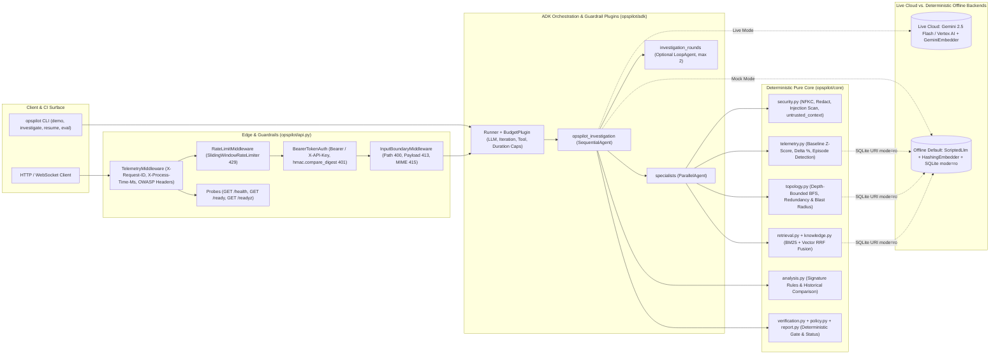
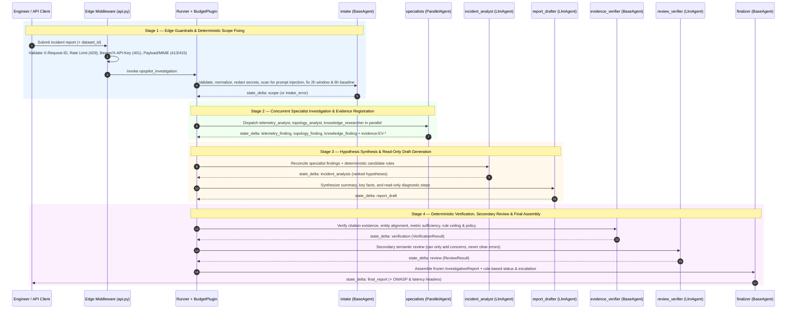
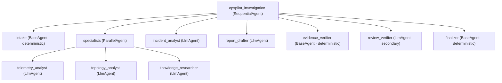
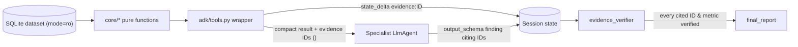
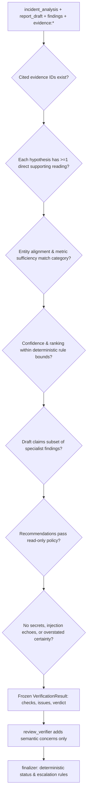

# ARCHITECTURE.md — OpsPilot AI

## 1. Layered System Architecture (`flowchart LR`)

Rule: `opspilot/contracts/` and `opspilot/core/` never import `google.adk`, `google.genai`, or `fastapi`. Every Pydantic contract and core DTO is immutable (`ConfigDict(frozen=True)` or `@dataclass(frozen=True)`). The ADK and FastAPI layers are thin adapters over `opspilot/core/`.



## 2. End-to-End Runtime Sequence (`sequenceDiagram`)



## 3. Package Layout

```text
opspilot/
  contracts/   Frozen Pydantic models (ConfigDict(frozen=True)): requests, evidence, findings, verification, report (no ADK)
  core/        Deterministic pure logic: telemetry stats, topology graph, hybrid retrieval, hypothesis rules,
               verification, read-only policy, security & <untrusted_context> framing, auth, cost (no ADK)
  datasets/    Synthetic world: topology, knowledge corpus, main (C01-C14) & held-out (H01-H10) cases, SQLite generator
  adk/         Framework layer: tool wrappers, agents, callbacks, BudgetPlugin, model factory (Gemini or ScriptedLlm), runner
  eval/        Evaluation harness, p50/p95 latency & accuracy metrics, guardrail perturbations, verifier matrix
  api.py       GET /runs/{run_id}, GET /ready, GET /readyz, TelemetryMiddleware, RateLimitMiddleware,
               BearerTokenAuth, InputBoundaryMiddleware, create_app
  cli.py       opspilot command: build-data, investigate, demo, eval, list, show, resume, serve, token
adk_apps/opspilot_ai/agent.py   exposes root_agent for adk web / adk api_server
```

## 4. Agent Hierarchy



With `OPSPILOT_MAX_INVESTIGATION_ROUNDS=2`, `specialists` through `evidence_verifier` run inside a `LoopAgent` (max 2 rounds) ending in a deterministic `reinvestigation_gate` that retries failed stages; see [docs/orchestration.md](docs/orchestration.md#optional-re-investigation-rounds).

## 5. Evidence & Untrusted Data Flow

Tools are pure functions in `opspilot/core/`. Each ADK wrapper in `opspilot/adk/tools.py` validates arguments via Pydantic, calls the core function, and registers every returned `Evidence` object in session state under `evidence:<ID>`. IDs are content-derived (`EV-TEL-1a2b3c4d`), making tool invocations idempotent across retries and parallel branches.



## 6. Deterministic Verification Process



Status rules (`opspilot/core/report.py::decide_status`, deterministic):

| Status | Condition |
|---|---|
| `failed` | Run aborted (timeout/budget/exception) **or** all three specialists failed. |
| `inconclusive` | No hypothesis with non-historical support while anomalies exist, **or** a specialist failed, **or** critical telemetry missing for the leading hypothesis' component. |
| `requires_human_review` | Verification issues of severity `error` (unsupported claims, invalid citations, policy violations), contradicting evidence on the top hypothesis, weak/telemetry-artifact/application-side leading hypothesis, or `review_verifier` warnings. |
| `investigated` | Otherwise (including "no fault found" in normal operations). |

## 7. Bounded Execution & Edge Limits

| Limit | Mechanism | Default |
|---|---|---|
| Model requests | `RunConfig.max_llm_calls` + `BudgetPlugin.before_model_callback` | 40 |
| Tool invocations | `BudgetPlugin.before_tool_callback` returns an error result once exceeded | 60 |
| Iterations per agent | Per-agent model-call cap in `BudgetPlugin` | 8 |
| Investigation duration | `asyncio.timeout` around the run | 120 s |
| HTTP rate limit | `RateLimitMiddleware` (`RATE_LIMIT_PER_MINUTE`) | 120 req/min (`429`, `Retry-After: 60`) |
| HTTP payload cap | `InputBoundaryMiddleware` (`OPSPILOT_MAX_PAYLOAD_BYTES`) | 5 MiB (`413`) |
| Output size | Pydantic `max_length` on report fields + finalizer truncation (`limit_report_size`) | 60,000 chars |
| Retries | Live: `google-genai` `HttpRetryOptions` (bounded attempts); no unbounded retries anywhere | 2 attempts |
