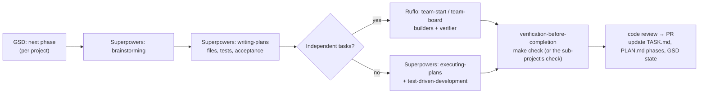

# Planning — agent-system

How work is planned in this repository and in each sub-project. This file is the process.
The content lives where it already is:

| What | Where |
|---|---|
| Design rationale, diagrams, phase status (OpsPilot) | [PLAN.md](PLAN.md), [ARCHITECTURE.md](ARCHITECTURE.md), `docs/adr/` |
| Backlog (done / next) | [TASK.md](TASK.md) |
| Sub-project plans | [api-tests/PLAN.md](api-tests/PLAN.md), [traffic-flow-analyzer/PLAN.md](traffic-flow-analyzer/PLAN.md), PlateWatch in [PLAN.md §7](PLAN.md#7-platewatch--why-pydanticai-here-platewatch), `ledger-hound/README.md` |

## Workflow: GSD → Superpowers → Ruflo

Every non-trivial change (new agent, tool, orchestration change, new sub-project, eval or
guardrail change) goes through three layers. Trivial fixes (one-line bug with a test) skip to
execution.

| Layer | Tool | Owns | Output |
|---|---|---|---|
| Roadmap | **GSD** (Get Shit Done) | Milestones and phases per project | `.planning/` state, mirrored in `TASK.md` and the project's `PLAN.md` phase table |
| Task plan | **Superpowers** | Design and step-by-step plan for one phase | `superpowers:brainstorming` → `superpowers:writing-plans` |
| Execution | **Ruflo** (Ai Team) | Parallel, independently verifiable tasks | `/team-start`, `/team-board`, `/team-review` |

## Rules for every plan

1. Name the project first. Sub-projects (`ledger-hound/`, `traffic-flow-analyzer/`, `platewatch/`,
   `api-tests/`) are planned and verified inside their own directory with their own `uv.lock`.
2. Each step lists the files, the tests and the acceptance check (`make check` at the root,
   `make check-all` when a change crosses projects).
3. Calculations, thresholds, rankings, statuses and policy gates are planned as pure functions
   in `opspilot/core/` (or the sub-project's core), never as prompt text.
4. A new LLM agent is planned with the `add-llm-agent` skill checklist (contract, prompt, mock
   policy, allowlist, tests). Dataset work uses `eval-dataset`; guardrail work uses `red-team`.
5. Live Gemini runs spend tokens: a plan that needs one says so and gets approval first.
6. Ruflo builders work on disjoint files; the verifier runs the check before anything merges.

Superpowers and Ruflo are Claude Code plugins (Anthropic plugin directory). GSD and graphify
run locally. In a session without them, follow the same steps by hand and record the outcome in
`TASK.md`. After a phase merges, refresh `graphify-out/` locally.
