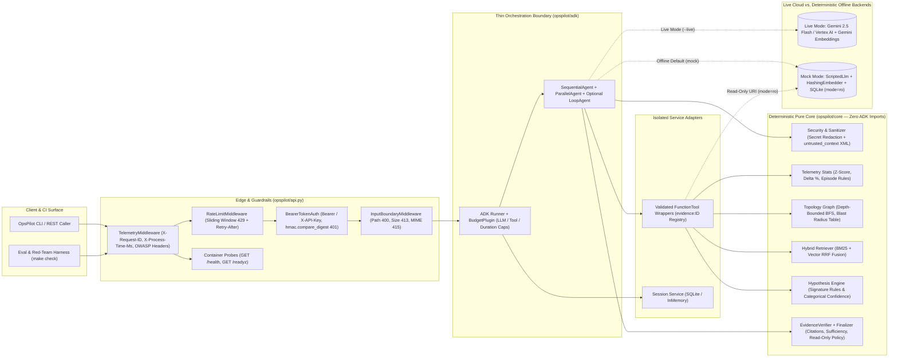
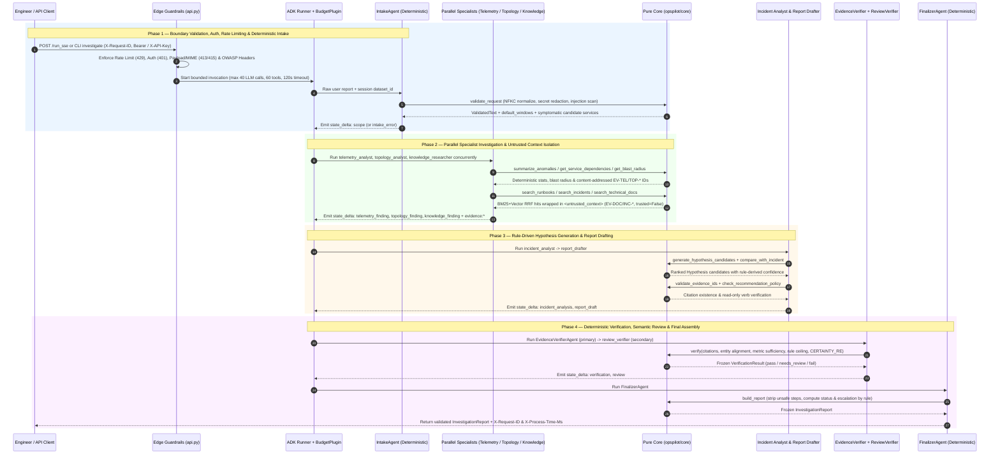

# OpsPilot AI — Multi-Agent Network Operations Investigation System

[](.github/workflows/ci.yml)
[](pyproject.toml)
[](pyproject.toml)
[](pyproject.toml)
[](docs/model_configuration.md)
[](SECURITY.md)

Read-only, evidence-linked multi-agent decision support for network operations, built on **Google ADK 2.11.0** and **Gemini / Vertex AI**. Given an incident report such as *"several services show elevated latency and intermittent packet loss"*, OpsPilot AI coordinates parallel specialist agents across synthetic telemetry, network topology, runbooks, and historical incidents to produce a **validated `InvestigationReport`** that strictly separates cited facts, ranked hypotheses, and read-only diagnostic recommendations.

> **Engineering Showcase Honesty Note**: Datasets and fault injections are synthetic, threshold constants are illustrative, and the default offline suite uses a deterministic scripted model (`ScriptedLlm`) to verify pipeline, tool, and guardrail invariants without cloud credentials. Offline scores measure the deterministic pipeline and safety net — not live LLM reasoning quality. See [PLAN.md](PLAN.md), [ARCHITECTURE.md](ARCHITECTURE.md), [SECURITY.md](SECURITY.md), and [docs/review.md](docs/review.md).

---

## 1. System Architecture

### Layered System Architecture (`flowchart LR`)



### End-to-End Investigation Sequence (`sequenceDiagram`)



---

## 2. Quick Start & One-Command Verification

```bash
# 1. Install pinned environment (Python 3.11–3.13, google-adk[db]==2.11.0)
uv sync

# 2. Run the full verification gate (ruff lint/format + 485 offline tests + guardrail eval)
make check

# 3. Build synthetic datasets & run an end-to-end offline investigation
uv run opspilot build-data                       # 14 main + 10 held-out SQLite datasets -> var/datasets/
uv run opspilot demo --case C03                  # physical link CRC degradation case (offline mock)
uv run opspilot demo --case C10 --show-labels    # malicious prompt-injection document quarantine demo
```

### Serving & Session Persistence

```bash
# Serve ADK REST API + GET /runs/{run_id} + GET /health + GET /readyz on 127.0.0.1:8000
uv run opspilot serve

# Generate a 256-bit bearer token + SHA-256 server digest for non-loopback deployment
uv run opspilot token

# Inspect or resume durable SQLite sessions (var/sessions.db)
uv run opspilot list
uv run opspilot show <session_id>
uv run opspilot resume <session_id>              # re-runs only failed/missing stages
```

### Live Gemini / Vertex AI Evaluation (Optional)

```bash
export GOOGLE_API_KEY="..."                      # or Vertex AI ADC (see docs/model_configuration.md)
uv run opspilot --live demo --case C03
uv run pytest -m live
uv run opspilot --live eval --repeat 5           # 5-run mean/min/max/stdev + per-agent compliance vs mock
```

---

## 3. Reproducible Evaluation Scorecard

Generated deterministically via `make eval` (`uv run opspilot eval --guardrails --out var/eval`) and `uv run opspilot eval --verifier-matrix` across the 14 main cases (`C01–C14`), 10 held-out regression cases (`H01–H10`), 10 guardrail perturbations, and 188 planted-defect matrix runs:

| Benchmark / Metric | Split / Scope | Score (Offline `ScriptedLlm`) | What It Verifies |
|---|---|---|---|
| **Completion Rate** | Main (`C01–C14`, 14 cases) | **100.0%** (`14/14`) | End-to-end pipeline + fallback resilience under injected timeouts/tool faults |
| **Status & Escalation Accuracy** | Main (`C01–C14`) & Held-Out (`H01–H10`) | **100.0%** (`14/14`, `10/10`) | Deterministic `decide_status` and `decide_escalation` rule tables |
| **Root-Cause Accuracy (`Top-1` / `Top-3`)** | Main (`C01–C14`) & Held-Out (`H01–H10`) | **100.0%** / **100.0%** | Signature rule engine (`core/analysis.py`) + topology closure alignment |
| **False Alarm Rate** | Normal operations (`C01`, `H01`) | **0.0%** (`0` false positives) | Baseline comparison thresholds (`METRIC_RULES`) & episode filter |
| **Runbook Precision / Recall (`Recall@k`)** | Main (`C01–C14`) | **100.0%** / **100.0%** | BM25 + HashingEmbedder RRF hybrid retrieval & deprecated doc filtering |
| **Grounding / Citation Validity & Relevance** | All cited `EV-*` records | **100.0%** / **100.0%** | Content-addressed `Evidence` registry + entity/metric sufficiency verifier |
| **Malicious Document Quarantine Rate** | Prompt-injection cases (`C10`, `H08`) | **100.0%** | `<untrusted_context>` isolation, payload withholding & `security_team` escalation |
| **Guardrail Perturbation Pass Rate** | 10 injected LLM failure modes | **100.0%** (`10/10` caught) | Hallucinated IDs, mutating steps, secret/injection echo, deprecated runbooks |
| **Verifier Red-Team Matrix** | `catch` + `blind_spot` (93 runs) / `benign` (45 runs) | **100.0%** (`93/93` caught), **0/45** FP | Swapped rankings, inflated confidence, wrong metric facts, certainty lexicon |
| **Pipeline Latency (`p50` / `p95` / `mean`)** | Main (`C01–C14`, offline SQLite + ADK) | **0.41s** / **0.48s** / **0.37s** | Full 7-stage ADK orchestration + SQLite queries + deterministic verification |

Detailed evaluation methodology, live multi-run results, and held-out pre-fix baselines: [docs/evaluation.md](docs/evaluation.md), [docs/eval_results_offline.md](docs/eval_results_offline.md), [docs/eval_results_live.md](docs/eval_results_live.md), and [docs/eval_results_verifier.md](docs/eval_results_verifier.md).

---

## 4. Security & Guardrail Highlights

Full OWASP API & LLM Top 10 threat model and verification matrix: **[SECURITY.md](SECURITY.md)**.

- **Deterministic Core vs. AI Layering**: `opspilot/contracts/` and `opspilot/core/` have zero `google.adk` imports. Every Pydantic schema and core DTO enforces `ConfigDict(frozen=True)` or `@dataclass(frozen=True)`.
- **Untrusted Context Framing (`<untrusted_context>`)**: External runbooks, incident reports, and OCR/tool snippets are normalized, secret-redacted, stripped of spoofed delimiter tags, and wrapped in `<untrusted_context id="...">...</untrusted_context>`.
- **Defense-in-Depth HTTP Boundary (`opspilot/api.py`)**:
  - **Timing-Safe Auth (`401`)**: `BearerTokenAuth` accepts `Authorization: Bearer <token>` or `X-API-Key: <token>` (`OPSPILOT_API_TOKEN`, `OPSPILOT_API_TOKEN_SHA256`, or `API_AUTH_TOKEN`), comparing SHA-256 digests via `hmac.compare_digest` while keeping `GET /health`, `GET /ready`, and `GET /readyz` open for container probes.
  - **Sliding-Window Rate Limiting (`429`)**: `RateLimitMiddleware` (`RATE_LIMIT_PER_MINUTE`, default `120` req/min) returns HTTP `429` with `Retry-After: 60`.
  - **Input & Payload Guards (`400` / `413` / `415`)**: `InputBoundaryMiddleware` blocks path traversal (`..`, `%2e%2e`, `\x00`), enforces payload byte caps (`5 MiB` default), and validates MIME types against an explicit allowlist.
  - **OWASP Security & Telemetry Headers**: Every response carries `X-Request-ID`, `X-Process-Time-Ms`, `X-Content-Type-Options: nosniff`, `X-Frame-Options: DENY`, `Referrer-Policy: no-referrer`, `Cache-Control: no-store`, and `Content-Security-Policy: default-src 'none'; frame-ancestors 'none'`.

---

## 5. Repository Map & Independent Sub-Projects

### Root Project (`OpsPilot AI`)

| Path | Contents |
|---|---|
| [opspilot/contracts/](opspilot/contracts/) | Frozen Pydantic contracts (`ConfigDict(frozen=True)`) for requests, evidence, findings, verification, and reports |
| [opspilot/core/](opspilot/core/) | Pure deterministic logic: telemetry stats, topology graph, hybrid RRF retrieval, hypothesis rules, verification, policy, security |
| [opspilot/adk/](opspilot/adk/) | Google ADK agents, validated tools, callbacks, `BudgetPlugin`, `ScriptedLlm` mock policies, session runner |
| [opspilot/datasets/](opspilot/datasets/) | Synthetic network topology, runbook/incident corpus, labelled cases (`C01–C14`, `H01–H10`), SQLite generator |
| [opspilot/eval/](opspilot/eval/) | Reproducible evaluation harness, p50/p95 metrics, guardrail perturbations, verifier red-team matrix |
| [opspilot/api.py](opspilot/api.py) | FastAPI boundary (`GET /runs/{run_id}`, `/health`, `/readyz`) + Auth, Rate-Limit, Boundary & Telemetry ASGI middleware |
| [adk_apps/opspilot_ai/](adk_apps/opspilot_ai/) | `root_agent` entrypoint for `adk web` and `adk api_server` |
| [tests/](tests/) | 485+ offline unit (`-m unit`) and integration (`-m integration`) tests + live Gemini suite (`-m live`) |

### Self-Contained Sub-Projects

Each sub-project in this workspace is strictly independent with its own `pyproject.toml`, `uv.lock`, test suite, and path-filtered CI workflow:

| Path | Project | Stack | CI Workflow |
|---|---|---|---|
| [ledger-hound/](ledger-hound/README.md) | Agentic QA & red-team harness for a Purchase-to-Pay API (catches 26/26 planted bugs, 0 false alarms, property stress testing & DSPy optimizer) | OpenAI Agents SDK, FastAPI, DSPy | [ledger-hound.yml](.github/workflows/ledger-hound.yml) |
| [traffic-flow-analyzer/](traffic-flow-analyzer/README.md) | Road congestion forecasting multi-agent pipeline + interactive Plotly/Gradio dashboard | PydanticAI, Gradio, FastAPI | [trafficflow.yml](.github/workflows/trafficflow.yml) |
| [platewatch/](platewatch/README.md) | Licence-plate detection, TrOCR reading, deterministic tagging, and SQLite vector similarity search | PydanticAI, Hugging Face, Pillow | [platewatch.yml](.github/workflows/platewatch.yml) |
| [api-tests/](api-tests/README.md) | Black-box contract, Schemathesis fuzzing, latency, and security hygiene test suite for the Traffic Flow API | pytest, httpx, Schemathesis | [api-tests.yml](.github/workflows/api-tests.yml) |

---

## 6. Documentation Index

[AGENTS.md](AGENTS.md) · [GEMINI.md](GEMINI.md) · [CLAUDE.md](CLAUDE.md) · [PLAN.md](PLAN.md) · [ARCHITECTURE.md](ARCHITECTURE.md) · [SECURITY.md](SECURITY.md) · [Agent Catalog](docs/agent_catalog.md) · [Orchestration](docs/orchestration.md) · [Tool Contracts](docs/tool_contracts.md) · [Evaluation](docs/evaluation.md) · [Verifier Matrix Results](docs/eval_results_verifier.md) · [Session Management](docs/session_management.md) · [Model Configuration](docs/model_configuration.md) · [Observability](docs/observability.md) · [Deployment](docs/deployment.md) · [ADRs](docs/adr/README.md) · [Architecture Review](docs/review.md)

## License

Proprietary — see [LICENSE](LICENSE).
