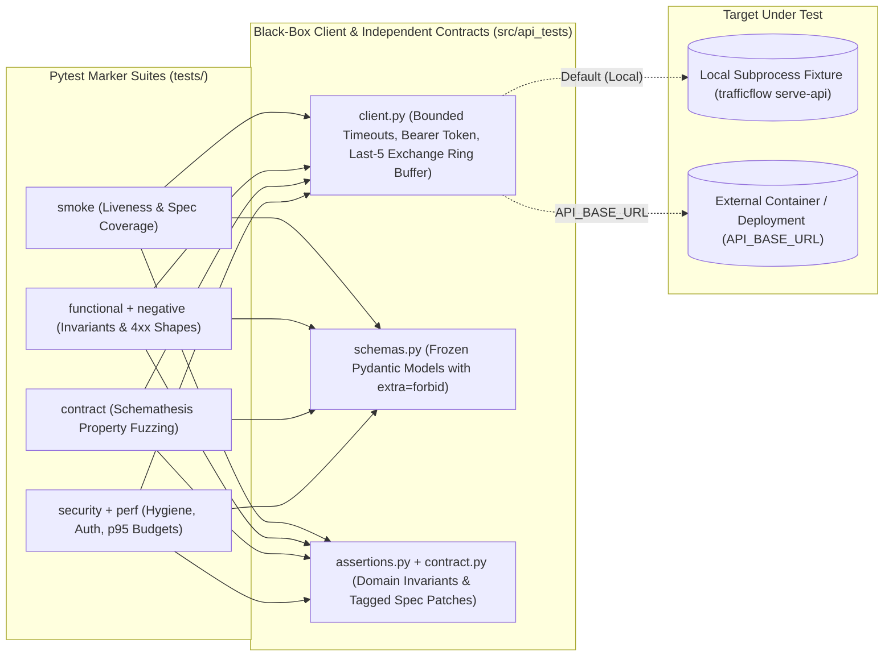
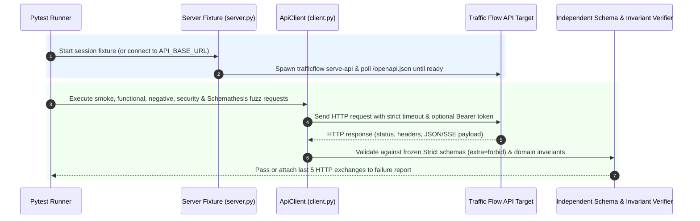

# api-tests — Black-Box Contract, Fuzzing & Security Test Suite

[](../.github/workflows/api-tests.yml)
[](pyproject.toml)
[](pyproject.toml)
[](src/api_tests/schemas.py)

A black-box API test suite for the **Traffic Flow API** (`../traffic-flow-analyzer`,
`trafficflow serve-api`). It talks to the service over HTTP only and imports none of its
code, so the same suite runs against a local process, a container or a deployed instance.

> Practice project. Not production software.

### Layered Test Harness Architecture (`flowchart LR`)



### End-to-End Black-Box Verification Sequence (`sequenceDiagram`)



## Quick start

```bash
cd api-tests
uv sync
uv run pytest                 # starts the target on a free port, runs everything but perf
```

Without `API_BASE_URL`, the session fixture runs `uv run trafficflow serve-api` in
`../traffic-flow-analyzer` (synthetic feed, mock model), waits for `/openapi.json` and
stops it at the end. Its log goes to `reports/server.log`.

Against a server you started yourself:

```bash
docker compose -f ../traffic-flow-analyzer/docker-compose.yml up -d api
API_BASE_URL=http://localhost:8000 uv run pytest
```

If the target requires `Authorization: Bearer <token>` (`TRAFFICFLOW_API_TOKEN`), set
`API_TOKEN` to the same value; without `API_BASE_URL`, setting `API_TOKEN` also starts the
local server with that token, so the whole suite runs end-to-end against an authenticated
instance (see the environment table below).

## What is tested

| Marker | Folder | What it checks |
|---|---|---|
| `smoke` | `tests/smoke/` | Every endpoint answers 2xx with the right content type; the spec lists every path. Run first: `-m smoke -x` |
| `functional` | `tests/functional/` | Response schemas (strict Pydantic models in `src/api_tests/schemas.py`) and data invariants: forecast steps and spacing, `lower ≤ speed ≤ upper`, peak = max point, level monotone in index, history window and ordering, routes are simple paths and each weight optimises its own metric, SSE events, interval clamp |
| `negative` | `tests/negative/` | Unknown ids → 404, malformed params/bodies → 422 with FastAPI's error shape, wrong methods → 405 |
| `contract` | `tests/contract/` | [Schemathesis](https://schemathesis.readthedocs.io) property-based fuzzing over `/openapi.json` with valid and invalid requests: no 5xx, documented status codes and content types, schema-valid bodies; plus checks that the spec matches what is sent |
| `security` | `tests/security/` | No stack traces or paths in error bodies, hostile ids (traversal, injection, 4 KB) rejected cleanly, large bodies don't crash it, no version in `server`, no permissive CORS, auth enforced when `API_TOKEN` is set |
| `known_defect` | `tests/known_defects/` | Defects found in the target, pinned as strict xfails — see [docs/FINDINGS.md](docs/FINDINGS.md) |
| `perf` | `tests/perf/` | p95 latency per endpoint against a budget. **Opt-in**: `-m perf` |
| `stateful` | `tests/stateful/` | A Hypothesis rule-based state machine runs long random sequences of calls against one live server, checking invariants that only make sense across a sequence (the segment list doesn't change mid-run, the feed's clock never runs backwards). **Opt-in**: `-m stateful` |

Separately, `loadtest/locustfile.py` is a Locust load test, outside the pytest suite — see
[docs/LOADTEST.md](docs/LOADTEST.md).

## Commands

```bash
uv run pytest -m smoke -x                          # fast liveness gate
uv run pytest -m "functional or negative"
uv run pytest -m contract                          # fuzzing, valid and invalid requests
API_FUZZ_MODES=positive uv run pytest -m contract  # schema-valid requests only
API_FUZZ_EXAMPLES=200 uv run pytest -m contract    # deeper fuzzing
uv run pytest -m perf                              # latency budgets
uv run pytest -m stateful                          # random call-sequence fuzzing
uv run pytest -n auto -m "not contract and not perf and not stateful"  # parallel (one server/worker)
uv run pytest --junitxml=reports/junit.xml         # CI report
API_TOKEN=$(openssl rand -hex 32) uv run pytest    # full suite, end-to-end with auth on
uv run ruff check . && uv run ruff format --check .
```

## Configuration (environment)

| Variable | Default | Meaning |
|---|---|---|
| `API_BASE_URL` | unset | Test this server instead of starting one |
| `API_TOKEN` | unset | Sent as `Authorization: Bearer …`. Also enables the auth test, and, when `API_BASE_URL` is unset, is passed to the local server as `TRAFFICFLOW_API_TOKEN`, so the whole suite then runs end-to-end against an authenticated instance |
| `API_TIMEOUT` | `10` | Per-request timeout, seconds |
| `API_TARGET_PROJECT` | `../traffic-flow-analyzer` | Project to start when `API_BASE_URL` is unset |
| `API_STARTUP_TIMEOUT` | `90` | Seconds to wait for the local server |
| `API_FUZZ_EXAMPLES` | `25` | Schemathesis examples per operation |
| `API_FUZZ_MODES` | `all` | `positive` limits fuzzing to schema-valid requests |
| `API_PERF_SAMPLES` / `API_PERF_P95_MS` | `20` / `500` | Perf sample count and p95 budget |
| `API_STATEFUL_EXAMPLES` / `API_STATEFUL_STEPS` | `15` / `20` | Call-sequence count and steps per sequence for `-m stateful` |

CI (`.github/workflows/api-tests.yml`) runs lint, `-m smoke -x`, then the default suite with
`--junitxml`, whenever `api-tests/` or `traffic-flow-analyzer/` changes; the JUnit report and
`reports/server.log` are uploaded as the `api-tests-reports` artifact.

Each test also has a 120 s hard timeout (pytest-timeout), so a hang fails the run
instead of stalling it.

## Layout

```
src/api_tests/
  config.py      settings from the environment
  client.py      httpx wrapper: base URL, timeout, bearer token, connect-only retries, exchange log
  server.py      starts/stops the target on a free port
  schemas.py     expected response models (independent of the target's own models)
  assertions.py  assert_status / assert_schema / assert_ok / assert_error / p95
  contract.py    OpenAPI prep for fuzzing (excludes /stream; holds tagged patches for open spec gaps)
tests/           one folder per marker (table above)
loadtest/        Locust load test (not part of the pytest suite; needs `uv sync --group load`)
docs/FINDINGS.md defects found, with reproduction curls and suggested fixes
docs/LOADTEST.md load test methodology and results
```

A failing test's report includes the last five HTTP exchanges (method, URL, status,
latency, body preview).

## Results on the current target

Nine findings, all fixed in the target and now guarded by regular tests: two medium (an
unbounded `horizon`, KD-02, and a 500 on incomplete `/ask` history, KD-08) and seven low.
See [docs/FINDINGS.md](docs/FINDINGS.md).

The load test ([docs/LOADTEST.md](docs/LOADTEST.md)) found a performance bottleneck, not a
correctness bug: `GET /status` recomputes every segment's forecast on every request, so its
latency grows roughly linearly with concurrent load (40 concurrent requests: ~18 s each, 0
failures). `/stream`, the endpoint most worth worrying about on paper (many held-open
connections), handles 60 concurrent viewers with no issue — it is `/status`'s synchronous,
per-request computation that doesn't scale, not the long-lived connections.
