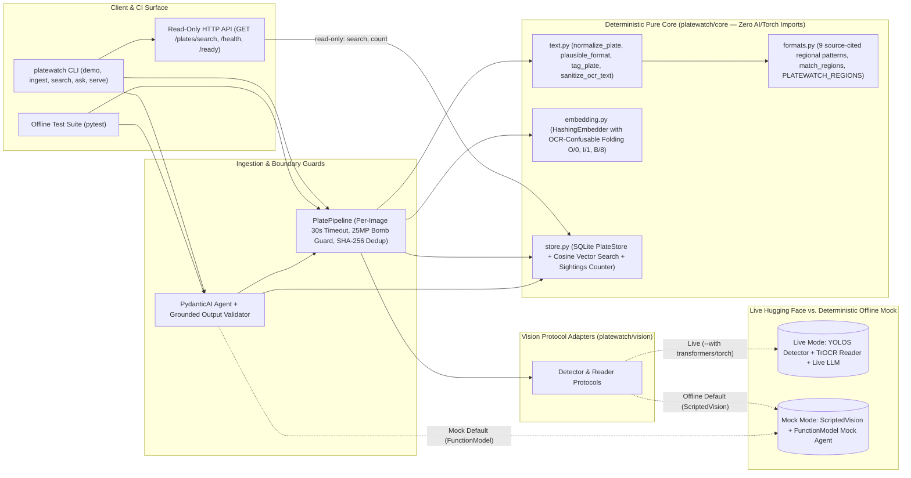
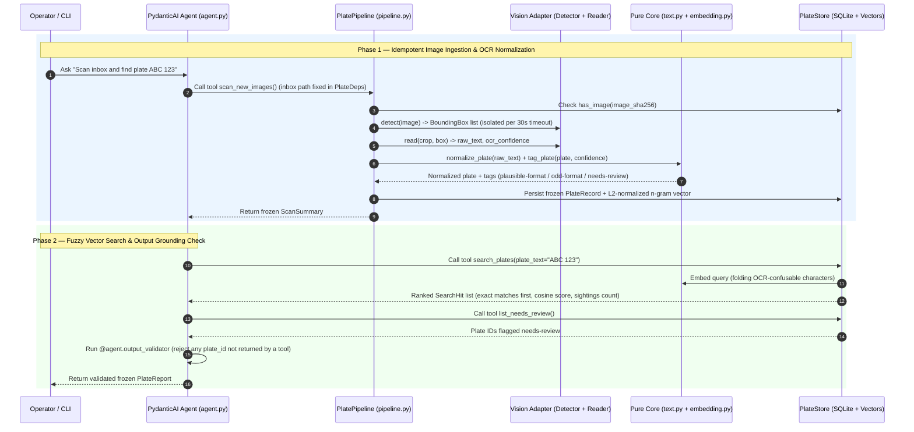

# PlateWatch — Vision & PydanticAI Licence-Plate Indexing

[](../.github/workflows/platewatch.yml)
[](pyproject.toml)
[](pyproject.toml)
[](src/platewatch/contracts.py)

Detect vehicle licence plates in images, read and normalize OCR text, tag confidence/format anomalies, persist embeddings in a searchable SQLite vector store, and query them through a grounded **PydanticAI** agent. Self-contained project (own `pyproject.toml`, `uv.lock`, test suite, and CI workflow); run commands from inside `platewatch/`.

---

## 1. System Architecture

### Layered System Architecture (`flowchart LR`)



### End-to-End Ingestion & Search Sequence (`sequenceDiagram`)



---

## 2. Quick Start & Commands

```bash
cd platewatch
uv sync
uv run ruff check . && uv run ruff format --check .
uv run pytest                                  # 100% offline suite (ScriptedVision + FunctionModel)
uv run platewatch demo                         # end-to-end offline ingestion + search + agent demo
```

### Read-Only Search API

```bash
uv run platewatch --db var/platewatch/plates.db serve        # 127.0.0.1:8001
curl 'http://127.0.0.1:8001/plates/search?q=AB12+CDE'
curl http://127.0.0.1:8001/ready                             # {"status":"ready","plates":2}
```

| Route | Purpose |
|---|---|
| `GET /plates/search?q=<text>&limit=<1-50>` | Fuzzy plate search; returns `SearchHit` objects |
| `GET /health`, `GET /ready` | Container probes, always unauthenticated |

Every route is a read. The database path comes from the process that starts the server, never
from a request, so `q` is plate text only — normalized and embedded, never used as a path or as
SQL. Write methods are not routed (`405`), and out-of-range input is rejected with `422`.

To require a token, configure digests rather than the token itself, so an environment dump does
not leak a credential:

```bash
export PLATEWATCH_API_TOKEN_SHA256=$(python -c "import hashlib,sys;print(hashlib.sha256(sys.argv[1].encode()).hexdigest())" "$MY_TOKEN")
uv run platewatch serve --host 0.0.0.0
curl -H "Authorization: Bearer $MY_TOKEN" 'http://127.0.0.1:8001/plates/search?q=AB12CDE'
```

Binding beyond loopback without a configured token is refused, rather than quietly serving an
open endpoint; `--allow-unauthenticated` overrides that only when an authenticating proxy sits in
front. **Rate limiting, per-user identity and TLS are not implemented**: put this behind a reverse
proxy that provides them before exposing it to a network.

### Regional Plate Formats (Optional)

Recognised plates gain a `region:<code>` tag. Nine regions are covered, each with its source cited
in `src/platewatch/core/formats.py`: `gb`, `fr`, `es`, `it`, `nl`, `us-ca`, `us-ny`, `us-tx`,
`us-fl`.

```bash
uv run platewatch demo                         # no region enforced: generic shape check unchanged
PLATEWATCH_REGIONS=gb,fr uv run platewatch demo   # only these regions count as plausible
```

With no region named, a plate passes on either a regional pattern or the generic shape check, so
enabling the table never rejects a plate the old check accepted. Naming regions makes the check
strict: anything outside them is tagged `odd-format` and `needs-review`.

### Live Hugging Face Vision & Live Agent (Optional)

```bash
# Ingest a directory of images with real Hugging Face YOLOS + TrOCR models
uv run --with transformers --with torch platewatch ingest <image_dir>

# Run live model accuracy evaluation against your own labelled photos (named <PLATE>.jpg)
PLATEWATCH_LIVE_DIR=<photos_dir> uv run --with transformers --with torch \
  pytest -m live tests/test_platewatch_live.py -s
```

---

## 3. Architectural Invariants & Honest Limits

- **Framework-Free Pure Core**: `src/platewatch/core/` never imports `pydantic_ai`, `torch`, `transformers`, or `google` (enforced by `tests/test_platewatch.py`).
- **Frozen Contracts**: Every model in `src/platewatch/contracts.py` (`BoundingBox`, `RawDetection`, `PlateRecord`, `SearchHit`, `ScanSummary`, `PlateReport`) enforces `ConfigDict(frozen=True)`.
- **No Model-Supplied Paths/SQL**: Agent tools take no file paths, URLs, or SQL from the model; the inbox directory is fixed in `PlateDeps`, and `@agent.output_validator` rejects any `plate_id` not returned by a tool in the current run.
- **A Format Pattern Is a Signal, Never a Gate**: a regex cannot be correct for any of these
  regions. Every one keeps older sequential formats legally on the road, issues personalised marks
  of arbitrary shape, and runs separate schemes for motorcycles, trailers, dealers, government and
  diplomatic vehicles, so any pattern narrow enough to carry information will reject legitimate
  plates. `tag_plate` therefore flags and never discards. Germany is deliberately absent: once
  separators are normalised away, `B-AB 1234` and `BA-B 1234` are the same string, and what remains
  collides with the New York, Texas and Florida patterns.
- **Honest Limits**: Default Hugging Face model weights (`nickmuchi/yolos-small-finetuned-license-plate-detection`, `microsoft/trocr-base-printed`) require live photo evaluation before quoting accuracy; the offline embedder is lexical (character n-grams with OCR-confusable folding), and search is an exact cosine scan suited for up to ~10^5 plates.
