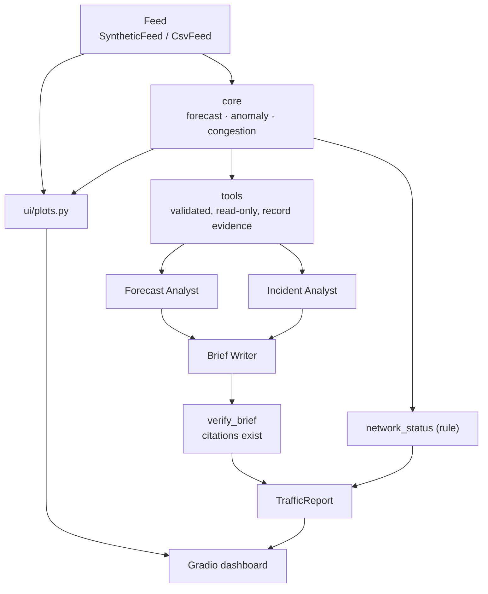

# ARCHITECTURE.md — Traffic Flow Analyzer

## Layering

```
trafficflow/
  contracts/   Pydantic models: segments, forecasts, anomalies, agent outputs, report  (no AI libs)
  core/        simulate, forecast, congestion, anomaly, status, backtest              (no AI libs)
  data/        Feed protocol; SyntheticFeed (deterministic, advancing clock); CsvFeed
  agents/      deps, tools, prompts, agent factories, mock models, pipeline
  ui/          plots.py (pure Plotly builders), app.py (Gradio Blocks)
  cli.py       trafficflow demo | backtest | serve
```

Rule: `contracts/` and `core/` never import `pydantic_ai` or `gradio`
(enforced by `tests/test_agents.py`). `agents/` adapts core functions into tools.

## Data flow



The plots and table are built straight from `core/` (no model calls). Only the briefing and
Ask tabs involve agents.

## Forecaster

For each segment, history is the last 7 days at 5-minute resolution:

* **Profile** — median speed per (minute-of-day, weekday/weekend).
* **Forecast(h)** — profile(t+h) + `0.92^h` × recent residual (mean of the last 3 readings).
* **Interval** — ± 1.645 × robust residual sigma (MAD), widening slowly with horizon.
* Needs at least 2 days of history, otherwise the tool returns `{"status": "error"}`.

Congestion index = 1 − speed / free-flow; levels at 0.2 / 0.4 / 0.6 (`core/congestion.py`).
Incidents: robust z ≤ −3.5 for ≥ 3 consecutive readings within the last 2 hours.

## Evidence flow

Each tool call records an `EV-nnn` entry in `TrafficDeps.evidence` and returns its id. Agents
must cite those ids; `verify_brief` rejects unknown ids and unknown segment ids. Evidence
ids are sequential per run (`EV-001`, `EV-002`, ...), unlike OpsPilot's content-derived ids.
Both analysts share one `TrafficDeps`; this is safe because `record()` is synchronous and
asyncio runs it without interleaving. Repeating a call records a new entry rather than
reusing an id. The writer never touches tools; it sees only the analysts' outputs.

## Safety properties

* Tools are read-only and take only a validated `segment_id` and a bounded horizon
  (5–180 min). No paths, SQL, URLs or commands.
* `SyntheticFeed.truth` (future data) is used only by `core/backtest.py`, never by tools.
* Status and escalation are computed in `core/`, not by an LLM.
* Prompt injection via the Ask tab is limited by the tool surface (read-only), not solved.

## Models

`resolve_model(role)` returns a deterministic `FunctionModel` when the model name is `mock`
(default) and otherwise the string in `TRAFFICFLOW_MODEL` (e.g. `google-gla:<model>`).
No model name is hardcoded.
