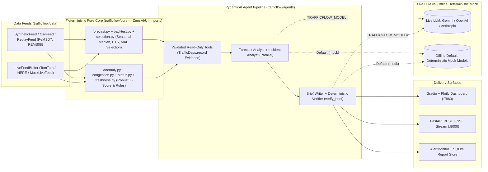
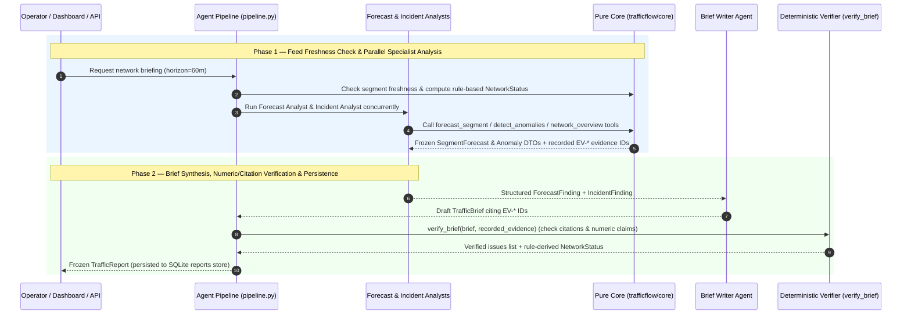

# Traffic Flow Analyzer — Multi-Agent Congestion Forecasting & Dashboard

[](../.github/workflows/trafficflow.yml)
[](pyproject.toml)
[](pyproject.toml)
[](trafficflow/ui/app.py)

Road congestion forecasting with parallel **PydanticAI** specialist agents, a deterministic statistical forecasting core, a FastAPI REST/SSE service, and an interactive **Gradio + Plotly** dashboard.

### Layered System Architecture (`flowchart LR`)



### End-to-End Briefing & Verification Sequence (`sequenceDiagram`)



## Quick start

```bash
cd traffic-flow-analyzer
uv sync
uv run pytest
uv run trafficflow serve        # http://127.0.0.1:7860
```

Dashboard tabs: speed history with forecast and 90% interval · segment × time congestion
heatmap · status table · "Live" mode · AI briefing · Ask (keeps conversation context) ·
Map · History. Briefings are persisted in SQLite (`serve --reports var/reports.db`, the
default) so the history survives restarts.

## Docker / Deployment

```bash
# Build
docker build -t trafficflow .

# Run (synthetic feed by default; set TRAFFICFLOW_MODEL for a live LLM)
docker run -p 7860:7860 -e TRAFFICFLOW_MODEL=google-gla:gemini-2.0-flash -e GOOGLE_API_KEY=<key> trafficflow
```

The dashboard is served at `http://localhost:7860`. To use a real CSV feed, mount it and pass
`--csv`: `docker run -p 7860:7860 -v /path/to/feed.csv:/data/feed.csv trafficflow uv run trafficflow serve --host 0.0.0.0 --csv /data/feed.csv`.

## Real data

```bash
uv run trafficflow fetch-data                      # PeMSD7 -> var/data (SHA-256 checked, not committed)
uv run trafficflow fetch-data --dataset pems08     # PEMS08 (includes weekends) -> var/data/pems08.npz
uv run trafficflow evaluate var/data/PeMSD7_V_228.csv --split          # held-out half only
uv run trafficflow evaluate var/data/pems08.npz --split --period weekend
uv run trafficflow serve --replay var/data/PeMSD7_V_228.csv --sensors 8   # dashboard on real recordings
```

**Result on real data.** Forecaster constants were tuned on the first half of the PeMSD7
origins only. The table below is the held-out second half (38 sensors, weekdays, 06:00–20:00).
MAE is in km/h.

| Horizon | Model MAE | Persistence MAE | 90% interval coverage | Mean width |
|---|---|---|---|---|
| 15 min | 4.69 | 4.92 | 0.90 | 21 km/h |
| 30 min | 6.37 | 7.23 | 0.90 | 29 km/h |
| 60 min | 7.71 | 11.02 | 0.90 | 35 km/h |

- **All 228 PeMSD7 sensors:** the same picture (4.68 / 6.34 / 7.67 MAE).
- **PEMS08 weekdays:** a different dataset, never used for tuning. The model beats
  persistence at every horizon.
- **PEMS08 weekends:** the model only ties persistence.
- **Intervals:** calibrated, but wide.

Details and caveats: [docs/eval_results_pems.md](docs/eval_results_pems.md).

## Using a real CSV feed

Point the dashboard at any CSV that has a `timestamp` column (ISO-8601 or
parseable by pandas) and one `speed_kmh` column per segment (column names
become segment IDs).  An optional `free_flow_kmh` column sets the free-flow
speed; without it, the 95th-percentile of the first 7 days is used.

```bash
# One-shot: dashboard reads the file once at startup
uv run trafficflow serve --csv data/my_feed.csv

# Polling: re-read the file every 30 s so new rows appended by an upstream
# process are picked up on the next dashboard refresh
uv run trafficflow serve --csv data/my_feed.csv --poll-seconds 30
```

`--csv` and `--replay` are mutually exclusive; omit both for the simulated feed.

## Live model validation

To run the full agent pipeline with a real LLM instead of the offline mock:

```bash
# 1. Set the model string (pydantic-ai format) and the provider's API key.
#    Supported providers: google-gla (Gemini), openai, anthropic
export TRAFFICFLOW_MODEL=google-gla:gemini-2.0-flash
export GOOGLE_API_KEY=<your-key>          # or OPENAI_API_KEY / ANTHROPIC_API_KEY

# Other supported model strings:
#   openai:gpt-4o
#   anthropic:claude-3-5-sonnet-latest

# 2. Run the validate command against the simulated feed.
uv run trafficflow validate --segment S1 --horizon 60
```

The command prints the full `TrafficReport` as JSON to stdout. Any numeric-claim
warnings (numbers in the brief that don't match the recorded evidence) are written to
stderr. Exit code is 0 on success, 1 when the brief verifier finds >50% unsupported
numeric claims or when no model is configured.

`--model` overrides the env var for one run:
```bash
uv run trafficflow validate --model openai:gpt-4o --segment S2 --horizon 30
```

> **Note:** Live-model output is not asserted in the test suite (outputs vary).
> The mock model (`TRAFFICFLOW_MODEL` unset or `"mock"`) is the default for CI.

## Live traffic API adapters

`trafficflow/data/live.py` provides `LiveFeedBuffer`, a thread-safe rolling 7-day buffer that
satisfies the `Feed` protocol. It is seeded with synthetic history so forecasts work at once;
polled readings layer on top. Adapters are included for **TomTom** (`TomTomLiveFeed`),
**HERE** (`HereLiveFeed`) and an offline `MockLiveFeed`. Review each provider's terms before
using it against the real API.

```bash
uv run trafficflow serve --live --provider tomtom --api-key $TOMTOM_API_KEY --poll-seconds 60
```

To add another provider, override `_fetch_current()`:

```python
from trafficflow.contracts import SegmentInfo
from trafficflow.data.live import LiveFeedBuffer


class MyFeed(LiveFeedBuffer):
    def _fetch_current(self) -> dict[str, float]:
        return my_client.latest_speeds()  # {segment_id: speed_kmh}


feed = MyFeed(segments=[SegmentInfo(id="A1", name="Main St", free_flow_kmh=80)])
feed.start_polling(interval_seconds=30)
```

Segments with no reading in the last 15 minutes are reported as `stale`. Stale segments rule
out a NORMAL network status.

## REST API and alerts

```bash
uv sync --extra api
uv run trafficflow serve-api --port 8000      # /segments /status /forecast/{id} /history/{id} /ask
uv run trafficflow monitor --level heavy --webhook https://example.invalid/hook
```

The monitor polls a live feed and POSTs to the webhook when a segment reaches the chosen
congestion level. It never calls a model.

Set `TRAFFICFLOW_API_TOKEN` (or pass `--token`) to require
`Authorization: Bearer <token>` on every route. Unset, the API is open. This is one static
shared secret — enough to keep a demo instance off the open internet, not a production
auth system.

```bash
uv run trafficflow serve-api --port 8000 --token "$(openssl rand -hex 32)"
curl -H "Authorization: Bearer <token>" localhost:8000/segments
```

## Honest scope

- **The default feed is simulated** (`SyntheticFeed`). Recorded data can be replayed with
  `ReplayFeed` (PeMSD7 or PEMS08) or loaded with `CsvFeed`; both only advance a clock over a
  recording. The TomTom and HERE adapters exist but have not been validated against the real
  APIs.
- **PeMSD7 and PEMS08 assumptions:** timestamps and units are reconstructed, because neither
  file contains them. See [ADR-0004](docs/adr/0004-pemsd7-data-assumptions.md) and
  [ADR-0005](docs/adr/0005-pems08-data-assumptions.md). The data-use terms are unverified.
- **Forecaster:** an interpretable seasonal median with a decaying residual, blended toward
  the latest reading.
- **Model selection is a rule, not an LLM choice.** A backtest picks the lowest-MAE forecaster
  per segment, and the agents only explain the result.
- **Map coordinates** are fixed demo positions. Replayed sensors have no real coordinates.
- Offline runs use deterministic mock models, not an LLM. For a real model set
  `TRAFFICFLOW_MODEL` (e.g. `google-gla:<model>`) plus that provider's API key; live output is
  untested here.
- Read-only decision support; not production-ready.

## Docs

[PLAN.md](PLAN.md) (why) · [ARCHITECTURE.md](ARCHITECTURE.md) (how) · [TASK.md](TASK.md) (backlog) · [docs/adr/](docs/adr/README.md)
