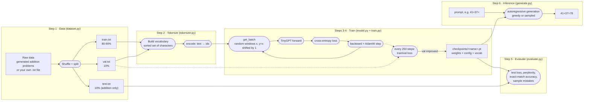
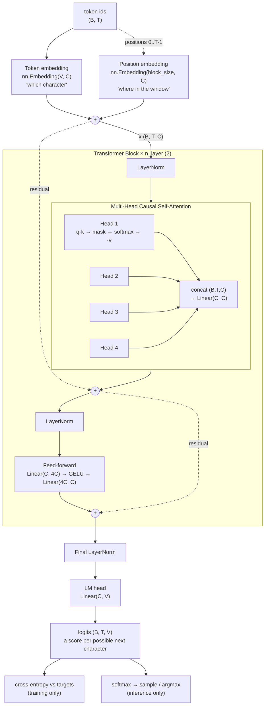
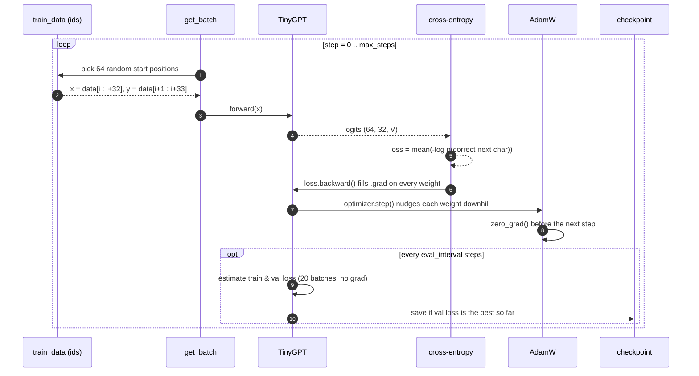

# train-small-model

**Train a tiny GPT-style language model from scratch, on your own data, on a laptop CPU, and
understand every line of it.**

This is a learning project, not production code. The goal is to make the full pipeline of
training a model visible and small enough to read in one sitting: build a custom dataset,
tokenize it, define a transformer, train it, evaluate it honestly, and use it.

* **[notes.md](notes.md)** is the lesson: a step-by-step walkthrough that assumes no ML
  background, defines every term, and explains *why* each step exists. **Start there.**
* This README is the map: what the pieces are, how they connect, and how to run them.

With the default settings the model has about 100,000 parameters, trains in about a minute on a
CPU, and gets around **95% of unseen two-digit addition problems right** (it was never shown those
problems during training, so it had to learn something like addition rather than memorise answers).

---

## Contents

- [What you will learn](#what-you-will-learn)
- [Prerequisites](#prerequisites)
- [Setup](#setup)
- [Quick start (the whole pipeline in five commands)](#quick-start)
- [Pipeline flow](#pipeline-flow)
- [Model architecture](#model-architecture)
- [Inside one training step](#inside-one-training-step)
- [Project layout](#project-layout)
- [Running each step in detail](#running-each-step-in-detail)
- [Using your own dataset](#using-your-own-dataset)
- [Configuration reference](#configuration-reference)
- [Expected results](#expected-results)
- [Tests](#tests)
- [Troubleshooting](#troubleshooting)
- [Design choices (and why)](#design-choices-and-why)
- [Next steps](#next-steps)

---

## What you will learn

| Concept | Where it lives | Notes section |
|---|---|---|
| Building a custom dataset; train / validation / test splits; data leakage | `tinymodel/dataset.py` | Part 2 |
| Tokenization (text ↔ integers), vocabularies | `tinymodel/tokenizer.py` | Part 3 |
| Inputs, targets and batches; context length | `tinymodel/train.py` (`get_batch`) | Part 4 |
| Embeddings, logits, softmax, cross-entropy loss | bigram snippet in notes | Part 5 |
| Self-attention, causal masking, multi-head attention, feed-forward, residuals, LayerNorm | `tinymodel/model.py` | Part 6 |
| Forward/backward pass, gradient descent, AdamW, hyperparameters, early stopping | `tinymodel/train.py` | Part 7 |
| Loss, perplexity, exact-match accuracy, error analysis, over/underfitting | `tinymodel/evaluate.py` | Part 8 |
| Autoregressive generation, greedy vs sampling, temperature | `tinymodel/generate.py` | Part 9 |
| Repeating it all on your own text | `examples/my_text.txt` | Part 10 |

---

## Prerequisites

* **Python 3.11 or newer.**
* **[uv](https://docs.astral.sh/uv/getting-started/installation/)**, the package manager used across
  this repository (`curl -LsSf https://astral.sh/uv/install.sh | sh`, or `brew install uv`).
* **No GPU needed.** A laptop CPU is enough. If you have an NVIDIA GPU (CUDA) or an Apple Silicon
  Mac (MPS), the code uses it automatically.
* **About 1 to 3 GB of disk** for PyTorch.
* **Knowledge:** basic Python (functions, lists, classes). No prior machine learning or calculus is
  required; notes.md introduces everything it uses.

---

## Setup

From the repository root:

```bash
cd train-small-model
uv sync                 # creates .venv/ and installs torch (+ pytest, ruff for development)
uv run pytest -q        # 7 checks, a few seconds; all should pass
```

All commands below are run from inside `train-small-model/`. Generated data goes to `data/` and
trained models to `checkpoints/`; both are git-ignored.

---

## Quick start

```bash
uv run python -m tinymodel.dataset addition                        # 1. make the dataset
uv run python -m tinymodel.tokenizer                               # 2. see tokenization in action
uv run python -m tinymodel.train    --data data/addition           # 3-4. build + train the model (~1 min)
uv run python -m tinymodel.evaluate --checkpoint checkpoints/addition.pt --data data/addition   # 5. evaluate
uv run python -m tinymodel.generate --checkpoint checkpoints/addition.pt --prompt "41+37="      # 6. use it
```

---

## Pipeline flow

The end-to-end flow, from raw data to a model answering questions. Solid boxes are files; rounded
boxes are steps (each one is a module in `tinymodel/`).



The same flow in plain text, if your viewer doesn't render Mermaid:

```
                 ┌──────────────────────── Step 1: dataset.py ─────────────────────────┐
 raw data ──────►│ shuffle ─► split ─► train.txt (80%)  val.txt (10%)  test.txt (10%)  │
                 └──────────────────────────────┬────────────────┬───────────┬─────────┘
                                                │                │           │
                 ┌──── Step 2: tokenizer.py ────▼───┐            │           │
                 │ vocabulary = sorted(set(chars))  │            │           │
                 │ encode: "7+12=19" -> [4,1,2,...] │            │           │
                 └──────────────┬───────────────────┘            │           │
                                │ ids                            │           │
 ┌───────────── Steps 3-4: model.py + train.py ──────────────────▼─────┐     │
 │  get_batch ─► TinyGPT ─► loss ─► backward ─► AdamW ─┐  every 250    │     │
 │      ▲                                              │  steps: val   │     │
 │      └──────────────── repeat 3,000x ───────────────┘  loss check   │     │
 │                                               best so far? ─► save checkpoint
 └───────────────────────────────────────────────────────────┬─────────┘     │
                                                             │               │
                 ┌──── Step 5: evaluate.py ◄─────────────────┤◄──────────────┘
                 │ test loss, perplexity, accuracy, mistakes │
                 └───────────────────────────────────────────┤
                 ┌──── Step 6: generate.py ◄─────────────────┘
                 │ "41+37=" ─► predict, append, repeat ─► "41+37=78"
                 └───────────────────────────────────────────
```

---

## Model architecture

`TinyGPT` is a decoder-only transformer, the same family as GPT and Claude, scaled down. Shapes
use **B** = batch size (64), **T** = sequence length (≤ 32), **C** = embedding width (64),
**V** = vocabulary size (13 for addition).



### Inside one attention head

```
 x (B,T,C) ──┬──► Linear ─► query q (B,T,16)  "what am I looking for?"
             ├──► Linear ─► key   k (B,T,16)  "what do I contain?"
             └──► Linear ─► value v (B,T,16)  "what do I hand over?"

 scores = q @ kᵀ / √16                       (B,T,T)  every position vs every position
 scores[above diagonal] = -inf               causal mask: position t only sees 0..t
 weights = softmax(scores, along each row)   rows sum to 1
 out = weights @ v                           (B,T,16) weighted mix of earlier positions

          s=0   s=1   s=2   s=3              The causal mask (1 = allowed to look):
   t=0  [  1     0     0     0  ]
   t=1  [  1     1     0     0  ]            Without it the model could read the
   t=2  [  1     1     1     0  ]            very character it is asked to predict.
   t=3  [  1     1     1     1  ]
```

### Parameter budget (defaults)

| Component | Shape | Parameters |
|---|---|---|
| Token embedding | 13 × 64 | 832 |
| Position embedding | 32 × 64 | 2,048 |
| Per block: attention (q, k, v for 4 heads + output projection) | 3 × 64×64 + 64×64 + 64 | 16,448 |
| Per block: feed-forward | 64×256 + 256 + 256×64 + 64 | 33,088 |
| Per block: 2 × LayerNorm | 2 × 128 | 256 |
| **× 2 blocks** | | 99,584 |
| Final LayerNorm + LM head | 128 + 64×13 + 13 | 973 |
| **Total** | | **103,437** |

---

## Inside one training step



---

## Project layout

```
train-small-model/
├── README.md              ← you are here: the map
├── notes.md               ← the lesson: read this step by step
├── pyproject.toml         ← dependencies (torch) and tool config
├── examples/
│   └── my_text.txt        ← a small sample text for the "your own data" walkthrough
├── tinymodel/
│   ├── __init__.py
│   ├── config.py          ← hyperparameters (ModelConfig, TrainConfig) and device selection
│   ├── dataset.py         ← Step 1: generate/load data, split train/val/test
│   ├── tokenizer.py       ← Step 2: CharTokenizer (encode/decode, save/load)
│   ├── model.py           ← Step 3: TinyGPT (Head, MultiHeadAttention, FeedForward, Block)
│   ├── train.py           ← Step 4: get_batch, estimate_loss, the training loop
│   ├── checkpoint.py      ← save/load weights + config + tokenizer together
│   ├── evaluate.py        ← Step 5: loss, perplexity, exact-match accuracy, mistakes
│   └── generate.py        ← Step 6: inference / text generation
├── tests/
│   └── test_pipeline.py   ← fast checks for every step
├── data/                  ← (generated, git-ignored) data/<name>/{train,val,test}.txt
└── checkpoints/           ← (generated, git-ignored) <name>.pt and <name>.history.json
```

Dependency direction (no cycles; each step only uses earlier ones):

```
config ◄── model ◄── checkpoint ◄── evaluate, generate
  ▲          ▲           ▲
  └──────── train ───────┘
tokenizer ◄── train, checkpoint
dataset   (standalone: only writes files)
```

---

## Running each step in detail

### Step 1: create the dataset

```bash
uv run python -m tinymodel.dataset addition                 # all a+b for a, b in 0..99
uv run python -m tinymodel.dataset addition --max-operand 49 --name addition_small
```

Writes `data/addition/{train,val,test}.txt` (8,000 / 1,000 / 1,000 problems). The problems are
shuffled with a fixed seed *before* splitting, and no problem appears in two splits.

### Step 2: look at tokenization

```bash
uv run python -m tinymodel.tokenizer
```

Prints a small vocabulary and an encode/decode round trip. During training the tokenizer is built
automatically from `train.txt + val.txt` and saved inside the checkpoint.

### Steps 3 and 4: build and train the model

```bash
uv run python -m tinymodel.train --data data/addition
uv run python -m tinymodel.train --data data/addition --n-layer 4 --n-embd 128 --max-steps 5000
```

Every `--eval-interval` steps it prints train and val loss; whenever val loss improves it saves
`checkpoints/<dataset>.pt`. The full loss history goes to `checkpoints/<dataset>.history.json`.
Use `--out` to choose another checkpoint path (useful when comparing experiments).

### Step 5: evaluate

```bash
uv run python -m tinymodel.evaluate --checkpoint checkpoints/addition.pt --data data/addition
```

Reports loss and perplexity on the held-out split (`test.txt` if present, otherwise `val.txt`).
For the addition dataset it also asks the model every test problem and reports **exact-match
accuracy**, plus a few of its mistakes for error analysis.

### Step 6: inference

```bash
# Answer a question (greedy, stops at end of line)
uv run python -m tinymodel.generate --checkpoint checkpoints/addition.pt --prompt "41+37="

# Free generation: let the model invent and solve its own problems
uv run python -m tinymodel.generate --checkpoint checkpoints/addition.pt --max-new 60

# Text model, sampled with a temperature
uv run python -m tinymodel.generate --checkpoint checkpoints/my_text.pt \
    --prompt "The robin " --temperature 0.8 --max-new 250
```

---

## Using your own dataset

1. Put your text in a UTF-8 `.txt` file. Aim for at least 100 KB for meaningful results (more is
   better); a few KB works but will mostly be memorised.
2. Prepare it:

   ```bash
   uv run python -m tinymodel.dataset text --input path/to/your.txt --name mydata
   ```
3. Train (dropout helps on small data):

   ```bash
   uv run python -m tinymodel.train --data data/mydata --dropout 0.2 --block-size 64
   ```
4. Evaluate and generate:

   ```bash
   uv run python -m tinymodel.evaluate --checkpoint checkpoints/mydata.pt --data data/mydata
   uv run python -m tinymodel.generate --checkpoint checkpoints/mydata.pt --prompt "Once " --temperature 0.8
   ```

Prompts may only use characters that appear in your data (the tokenizer will tell you if not).
notes.md Part 10 walks through this with `examples/my_text.txt` and shows what overfitting looks
like.

---

## Configuration reference

All settings are flags on `tinymodel.train` (defaults in `tinymodel/config.py`).

| Flag | Default | Meaning |
|---|---|---|
| `--data` | `data/addition` | Folder with `train.txt` and `val.txt` |
| `--out` | `checkpoints/<data name>.pt` | Where to save the best checkpoint |
| `--block-size` | 32 | Context length in characters |
| `--n-embd` | 64 | Embedding width (must be divisible by `--n-head`) |
| `--n-head` | 4 | Attention heads per block |
| `--n-layer` | 2 | Number of transformer blocks |
| `--dropout` | 0.0 | Dropout probability (try 0.1 to 0.3 on small datasets) |
| `--batch-size` | 64 | Windows per training step |
| `--max-steps` | 3000 | Training steps |
| `--lr` | 0.003 | AdamW learning rate |
| `--eval-interval` | 250 | Steps between train/val loss checks |
| `--seed` | 1337 | Random seed for reproducibility |

---

## Expected results

Measured on a cloud CPU with the default settings; your timings will differ.

| Run | Params | Time | Result |
|---|---|---|---|
| Addition, 3,000 steps | 103k | ~70 s | val loss 1.14, test perplexity 3.1, **95% exact match on 500 unseen problems** |
| `examples/my_text.txt`, 1,500 steps, dropout 0.2 | ~108k | ~50 s | best val loss 1.84 at step 250, then **overfits** (train 0.34, val 2.59) |

Why is the addition loss "stuck" at about 1.1 and not 0? The question digits are random and can't
be predicted, so about 1.0 is the best any model can do on this data (notes.md Part 7 shows the
calculation).

---

## Tests

```bash
uv run pytest -q
uv run ruff check . && uv run ruff format --check .
```

`tests/test_pipeline.py` checks each step does what the notes claim: addition problems are correct,
splits don't overlap, the tokenizer round-trips and rejects unknown characters, targets are inputs
shifted by one, an untrained model's loss is close to `ln(vocab_size)`, the causal mask really hides
the future, and a short training run lowers the loss and saves a checkpoint that loads back.

---

## Troubleshooting

| Symptom | Likely cause | Fix |
|---|---|---|
| `FileNotFoundError: data/addition/train.txt` | Dataset not created yet | Run step 1, from inside `train-small-model/` |
| `characters [...] never appeared in the training data` | Prompt uses a character not in the vocabulary | Use only characters from your dataset |
| Loss goes up or becomes `nan` | Learning rate too high | Try `--lr 1e-3` or `3e-4` |
| Loss barely moves | Learning rate too low, or model too small | Raise `--lr`, add layers or width |
| Train loss falls, val loss rises | Overfitting | More data, `--dropout 0.2`, smaller model; the best checkpoint is already kept |
| Training is slow | Big settings on CPU | Lower `--n-embd`, `--n-layer`, `--block-size`, or `--max-steps` |
| `uv sync` downloads a very large torch on Linux | The default Linux wheel bundles CUDA | Fine to ignore; or install the CPU wheel from `https://download.pytorch.org/whl/cpu` |

---

## Design choices (and why)

* **Character-level tokenizer**: you can see every token and debug by eye. Real models use subword
  tokenizers (BPE); notes.md Part 3 explains the difference.
* **Synthetic addition as the default dataset**: answers are checkable, so evaluation is concrete
  and you can see generalisation (the model solves problems it never saw).
* **Attention written one head at a time**: slower than PyTorch's fused kernel, but every
  operation is visible and commented.
* **Best-checkpoint saving (early stopping)**: protects you from overfitting without extra flags.
* **Tokenizer and config saved inside the checkpoint**: the model can always be rebuilt exactly.
* **No external services, no API keys, no GPU required**: everything runs offline.
* **Not production code**: no distributed training, mixed precision, LR schedules or serving;
  notes.md "Where to go next" lists what you would add.

---

## Next steps

See the end of [notes.md](notes.md): experiments to try (removing the causal mask, learning-rate
sweeps, zero-padding numbers to fix the model's one-digit weakness, reversed answers) and how this
connects to fine-tuning pre-trained models.
